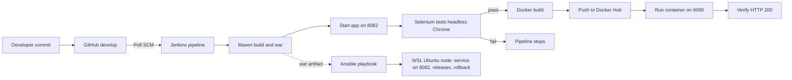

# Bank Branch Token Queue System

A containerized token queue management system for bank branches, built as a DevOps MVP project.

## Features

- Create, view, update, and search tokens
- Role-based status workflow (Waiting → Serving → Completed/Cancelled)
- Summary dashboard

## Tech Stack

Java 21, Spring Boot 3.3.4, Maven, H2 Database, Apache Tomcat

## Setup

1. Clone the repo
2. Run `mvn spring-boot:run`
3. Visit `http://localhost:8082`

## API Endpoints

| Method | Endpoint                | Purpose           |
| ------ | ----------------------- | ----------------- |
| POST   | /api/tokens             | Create a token    |
| GET    | /api/tokens             | View all tokens   |
| GET    | /api/tokens/{id}        | View one token    |
| PUT    | /api/tokens/{id}/status | Update status     |
| GET    | /api/tokens/search      | Search tokens     |
| GET    | /api/tokens/dashboard   | Dashboard summary |

## DevOps Workflow and Architecture

| Stage                             | What it does                              |
| --------------------------------- | ----------------------------------------- |
| Checkout, Build                   | Pull code, build the war                  |
| Start Application, Selenium Tests | Run 5 UI journeys headless                |
| Stop Test Application             | Free port 8082                            |
| Docker Build, Push to Docker Hub  | Versioned image 1.0.N and latest          |
| Deploy Container, Verify          | Replace container on 9090, check HTTP 200 |

### Run locally

`mvn spring-boot:run` then open http://localhost:8082/

### Ansible provisioning

From WSL, in the `ansible` folder:
`ansible-playbook -i inventory.ini provision.yml -K -e release_version=<version>`
`ansible-playbook -i inventory.ini healthcheck.yml -K`

## Project Status

- MVP complete, v1.0 released, Jenkins CI configured.
  DevOps MVP — Final Year Project, Vidyalankar Institute of Technology
## Troubleshooting

| Problem | Possible cause | Solution |
|---|---|---|
| Jenkins reports “No steps specified for branch” | Empty stage or incorrect branch configuration | Add valid steps to every stage and verify the branch specifier |
| Pipeline hangs at Start Application | Application runs in the foreground | Start the application as a separate process and configure a timeout |
| Port 8082 is already in use | A previous application process is still running | Identify and stop only the process using port 8082 |
| Selenium tests fail in Jenkins | Timing differences in headless Chrome | Use explicit waits and inspect test screenshots |
| Docker daemon connection fails | Docker Desktop is not running | Start Docker Desktop and check `docker info` |
| Docker Hub push is denied | Incorrect repository name or credentials | Verify the image name and Jenkins credentials |
| Container name already exists | An older container uses the same name | Stop and replace the old container safely |
| Jenkins does not detect a commit | Incorrect branch or SCM polling configuration | Check the branch specifier and polling schedule |
| Ansible reports systemd is unavailable | systemd is not enabled in WSL | Check WSL configuration before enabling systemd |
| Ansible cannot find the WAR file | Artifact missing from the expected path | Verify the WAR file exists in `ansible/artifacts` |

## Limitations

| Limitation | Impact |
|---|---|
| In-memory H2 database | Data is lost when the application restarts |
| Roles passed through a request header | Users can potentially claim unauthorized roles |
| Single deployment node | Deployment may cause brief downtime |
| Poll SCM instead of a webhook | Build detection can be delayed |
| Ansible executed manually | Provisioning is not fully integrated into CI/CD |
| Local WSL target | Does not represent a production remote server |
| Five Selenium journeys and Chrome only | Limited browser and test coverage |

## Future Enhancements

| Enhancement | Benefit |
|---|---|
| PostgreSQL database | Persistent application data |
| JWT authentication and real user accounts | Secure authentication and role authorization |
| Remote Ansible deployment over SSH | Automated deployment to a remote server |
| Multiple application nodes behind Nginx | Improved availability and load distribution |
| GitHub webhook integration | Faster build triggering |
| SonarQube and Trivy integration | Improved code and container security checks |
| Prometheus and Grafana | Monitoring, metrics and alerts |
| Selenium Grid | Cross-browser testing and broader coverage |
